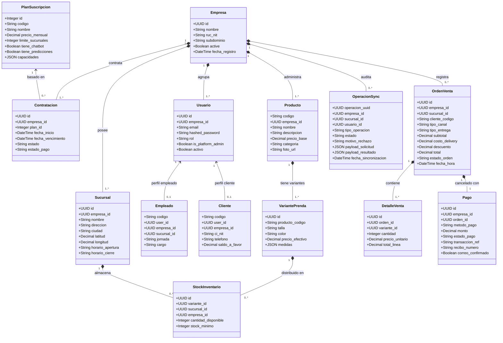
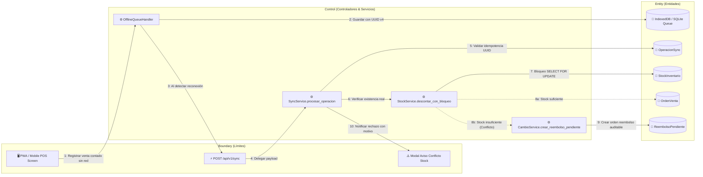
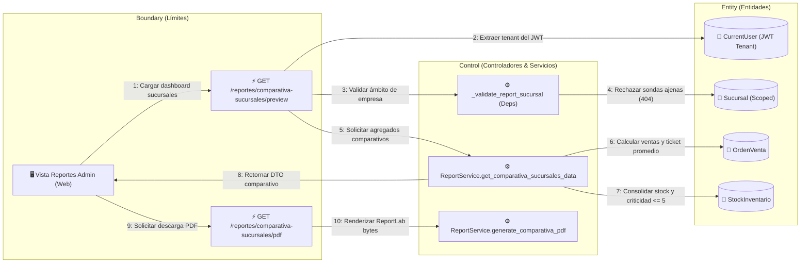
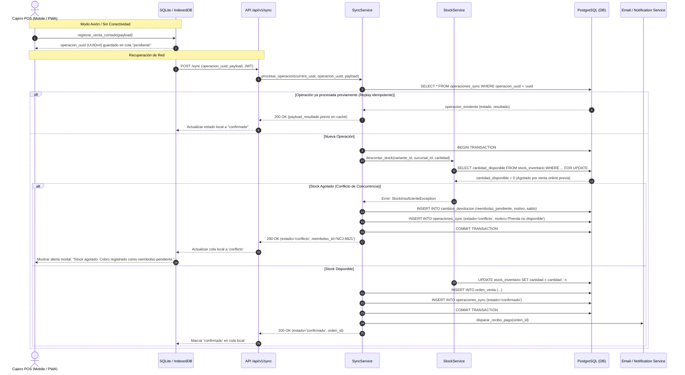
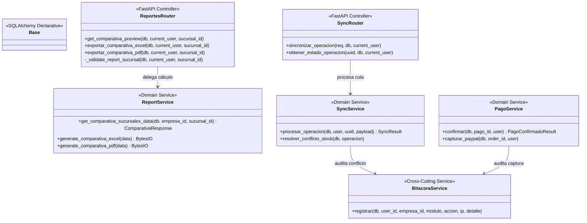
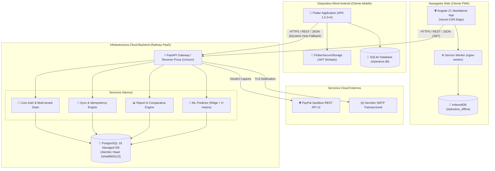
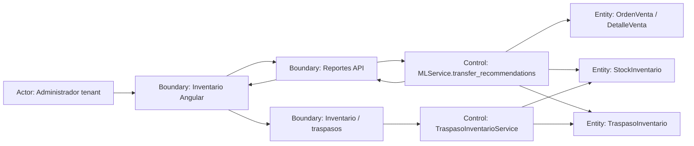
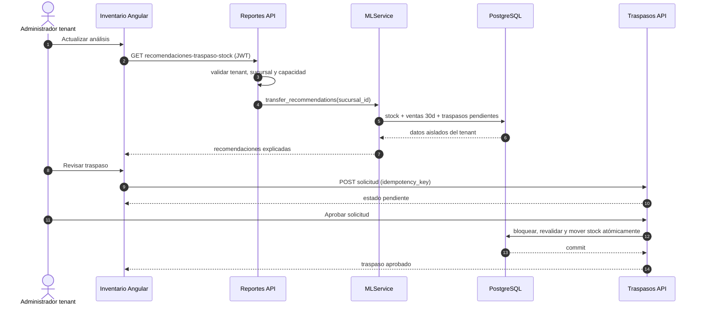

# Artefactos de Modelado ICONIX y UML 2.5+ — StyleStore SaaS (Segundo Parcial)

Fecha: 21/10/2026.  
Metodología: **ICONIX Process** (Rosenberg & Scott) adaptado para arquitectura Cloud Multi-tenant y PWA/Mobile Offline.  
Estándar de notación: **UML 2.5+** estructurado mediante diagramas Mermaid y especificación de flujos.  
Requisito matriz: `REQ-049 [P1]`.

---

## 1. Introducción y Metodología ICONIX

La metodología ICONIX es un enfoque ágil y estructurado entre el modelado exhaustivo del Proceso Unificado (PUDS) y el desarrollo rápido. Se compone de 4 fases iterativas:
1. **Modelado de Requisitos y Dominio:** Identificación de actores, glosario del dominio y diagrama de casos de uso.
2. **Análisis y Diseño Preliminar (Robustez):** Nexo entre el análisis ("qué") y el diseño ("cómo"), empleando los tres estereotipos:
   - **Boundary (Frontera/Límite):** Pantallas Web (Angular PWA), Vistas Mobile (Flutter) y Endpoints API REST (FastAPI).
   - **Control (Controlador/Servicio):** Capa de servicios (`AuthService`, `SyncService`, `ReportService`, `PagoService`, `CambioService`).
   - **Entity (Entidad):** Modelos de datos persistentes en PostgreSQL / SQLite.
3. **Diseño Detallado (Secuencia y Clases):** Asignación de responsabilidades a clases y mensajes síncronos/asíncronos.
4. **Implementación y Verificación:** Código fuente, migraciones Alembic y pruebas unitarias/E2E.

---

## 2. Modelo de Dominio del Negocio (Domain Model)

El modelo de dominio representa las entidades conceptuales del sistema SaaS multi-empresa, sus atributos esenciales y las relaciones de agregación y composición.



---

## 3. Modelo de Casos de Uso (Use Case Model)

### 3.1. Actores del Sistema
1. **Administrador SaaS:** Administrador supremo de la plataforma; gestiona contratos, empresas/tenants, catálogo de planes y respaldos globales.
2. **Administrador Tenant:** Responsable de una tienda o marca específica; administra sucursales, empleados, catálogo propio, inventario, reportes de empresa y renovación del plan.
3. **Encargado de Sucursal:** Supervisa el stock físico, transferencias entre tiendas y agenda de retiros/reservas en su sucursal.
4. **Cajero POS:** Registra ventas al contado o por QR en mostrador, procesa devoluciones/cambios y sincroniza colas offline.
5. **Cliente:** Navega el catálogo multitenant, guarda favoritos, realiza compras online o reservas, califica el servicio y gestiona su saldo a favor.
6. **Pasarela de Pagos (PayPal Sandbox):** Servicio externo que procesa autorizaciones y capturas de compras electrónicas seguras.

### 3.2. Diagrama General de Casos de Uso

```mermaid
graph LR
    actorSaaS["👤 Administrador SaaS"]
    actorAdmin["👤 Administrador Tenant"]
    actorCajero["👤 Cajero POS"]
    actorCliente["👤 Cliente"]
    pasarela["🌐 PayPal Sandbox API"]

    subgraph "Módulo 1: Plataforma & Suscripciones SaaS"
        CU01["CU-01: Gestionar Empresas / Tenants"]
        CU02["CU-02: Configurar Planes y Capacidades"]
        CU03["CU-03: Renovar / Cambiar Plan de Empresa"]
    end

    subgraph "Módulo 2: Operaciones Comerciales & POS"
        CU04["CU-04: Registrar Venta Presencial (Caja POS)"]
        CU05["CU-05: Realizar Checkout Online"]
        CU06["CU-06: Procesar Pago Electrónico"]
        CU07["CU-07: Sincronizar Ventas/Reservas Offline"]
    end

    subgraph "Módulo 3: Post-Venta & Fidelización"
        CU08["CU-08: Procesar Cambio o Devolución"]
        CU09["CU-09: Gestionar Reservas con Franja Horaria"]
        CU10["CU-10: Calificar Experiencia Poscompra"]
    end

    subgraph "Módulo 4: Analítica & Business Intelligence"
        CU11["CU-11: Comparar Rendimiento entre Sucursales"]
        CU12["CU-12: Consultar Predicciones ML y Reportes"]
    end

    actorSaaS --> CU01
    actorSaaS --> CU02

    actorAdmin --> CU03
    actorAdmin --> CU11
    actorAdmin --> CU12

    actorCajero --> CU04
    actorCajero --> CU07
    actorCajero --> CU08

    actorCliente --> CU05
    actorCliente --> CU09
    actorCliente --> CU10

    CU05 ..> CU06 : <<include>>
    CU06 --> pasarela
    CU07 ..> CU04 : <<resolves>>
```

---

## 4. Diagramas de Robustez ICONIX (Robustness Analysis)

El análisis de robustez conecta los casos de uso con el diseño de clases identificando objetos de Frontera (Boundary), Control (Control) y Entidad (Entity).

### 4.1. Robustez 1: Venta Presencial Offline y Sincronización con Resolución de Conflicto



### 4.2. Robustez 2: Comparativa de Rendimiento entre Sucursales (REQ-063)



---

## 5. Diagramas de Secuencia UML 2.5+ (Sequence Diagrams)

### 5.1. Secuencia: Sincronización Idempotente con Detección de Conflicto y Generación de Reembolso



---

## 6. Diagrama de Clases de Diseño (Design Class Diagram - UML 2.5)



---

## 7. Diagrama de Despliegue y Componentes (Deployment & Architecture Diagram)



---

## 8. Extensión ICONIX: redistribución predictiva de stock

### 8.1. Caso de uso CU-13 — Revisar y ejecutar recomendación de traspaso

**Actor principal:** Administrador tenant o encargado autorizado.

**Precondiciones:** usuario autenticado, plan con capacidad `predicciones`, dos o más sucursales del mismo tenant y stock comparable de la misma variante.
**Flujo básico:**

1. El actor abre Inventario y solicita actualizar el análisis.
2. El sistema agrupa stock por producto, color y talla dentro del tenant.
3. El sistema calcula velocidad de venta y cobertura de los últimos 30 días.
4. El sistema descuenta entradas/salidas de traspasos pendientes.
5. El sistema propone origen, destino y cantidad conservando la reserva del origen.
6. El actor revisa la explicación, ajusta si corresponde y crea la solicitud.
7. Un usuario autorizado aprueba el traspaso; recién entonces el backend mueve stock atómicamente.

**Flujos alternos:** sin capacidad de plan se responde 403; una sucursal ajena se responde 404; si cambia el stock antes de aprobar, se rechaza con conflicto y no se mueve ninguna unidad; repetir una solicitud con la misma clave idempotente devuelve el mismo traspaso.

### 8.2. Robustez



### 8.3. Secuencia de recomendación y aprobación



---

## 9. Verificación y Trazabilidad

- **Trazabilidad de Requisitos:** Los artefactos modelados cubren con rigor técnico los requerimientos `REQ-001` a `REQ-074`, en especial el diseño de sincronización offline (`REQ-013`, `REQ-023`–`REQ-036`), multitenancy (`REQ-003`–`REQ-007`), transacciones atómicas (`REQ-011`, `REQ-012`), reportes comparativos (`REQ-039`, `REQ-063`), analítica ML (`REQ-042`–`REQ-045`) y redistribución predictiva (`REQ-074`).
- **Validación:** El modelado se corresponde unívocamente con el código real versionado en los repositorios de GitHub de Backend, Frontend Web y Mobile.
